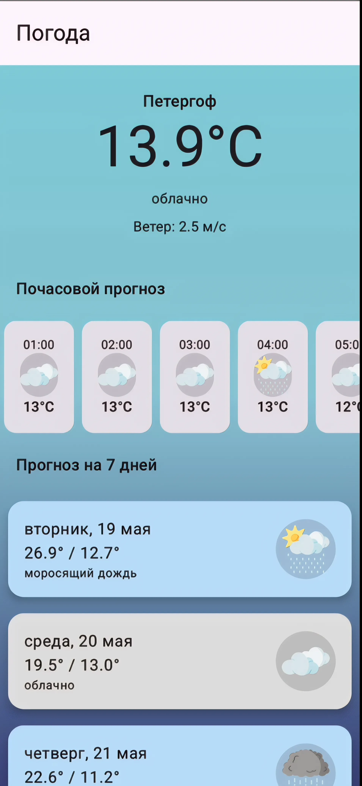
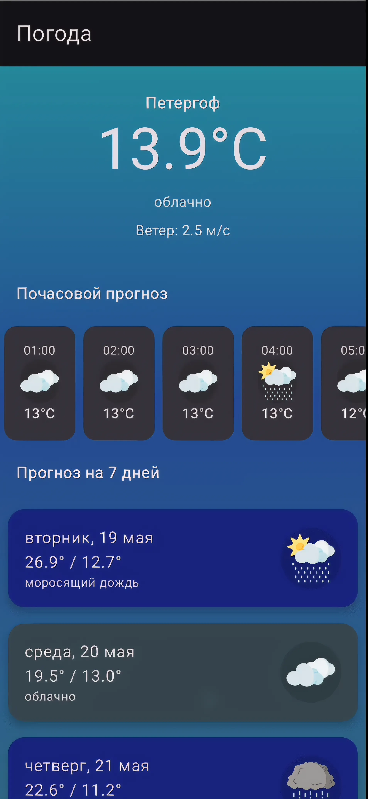

# WeatherViewer — приложение с прогнозом погоды

Приложение с прогнозом погоды на Android с кэшированием данных.

---

## Демонстрация работы

|                   Светлая тема                    |                   Тёмная тема                   |
|:-------------------------------------------------:|:-----------------------------------------------:|
|  |  |

[Скачать видео](docs/demo.mp4)

---

## Функциональность
- Получение прогноза погоды через Open-Meteo API
- Отображение текущей погоды, почасового и ежедневного прогноза
- Работа без интернета (кэширование данных)
- Прогноз на 7 дней с максимальной и минимальной температурой
- Детальный просмотр погоды по часам для каждого дня (клик по карточке)
- Адаптивные цвета карточек под тип погоды и тёмную тему
- Pull-to-refresh для обновления данных
- Индикация отсутствия интернета

## Технологии
- **Язык:** Kotlin
- **UI:** Jetpack Compose (Material 3)
- **Архитектура:** MVVM
- **DI:** Hilt
- **Сеть:** Retrofit + Kotlin Serialization
- **База данных:** Room
- **Тестирование:** JUnit, MockK, Turbine, Compose UI Testing

## Установка

* Чтобы загрузить проект по ссылке **https**, введите
```bash
git clone https://git@git.sourcecraft.dev/spbu-coding-2025/weather-kijjexs.git
```

* Чтобы загрузить проект по **SSH**, введите
```bash
git clone ssh://ssh.sourcecraft.dev/spbu-coding-2025/weather-kijjexs.git
```

## Сборка и тестирование

### Требования
- JDK 17
- Android API 29+

### Сборка
```bash
./gradlew assembleDebug
```

### Unit-тесты
```bash
./gradlew test
```

**Создайте отчет о покрытии (Kover)**

```bash
./gradlew koverHtmlReport
```

Откройте отчет в браузере:

```bash
app/build/reports/kover/html/index.html
```

### Android-тесты
```bash
./gradlew connectedCheck
```

## API
Используется бесплатное API [Open-Meteo](https://open-meteo.com/)

## Лицензия
Этот проект распространяется под лицензией MIT. Подробности в
[`LICENSE`](LICENSE)

## Иконки
Иконки погоды взяты с [Flaticon](https://www.flaticon.com/packs/weather-219)
